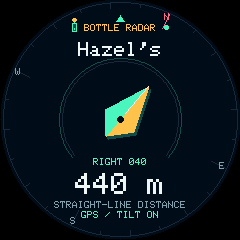
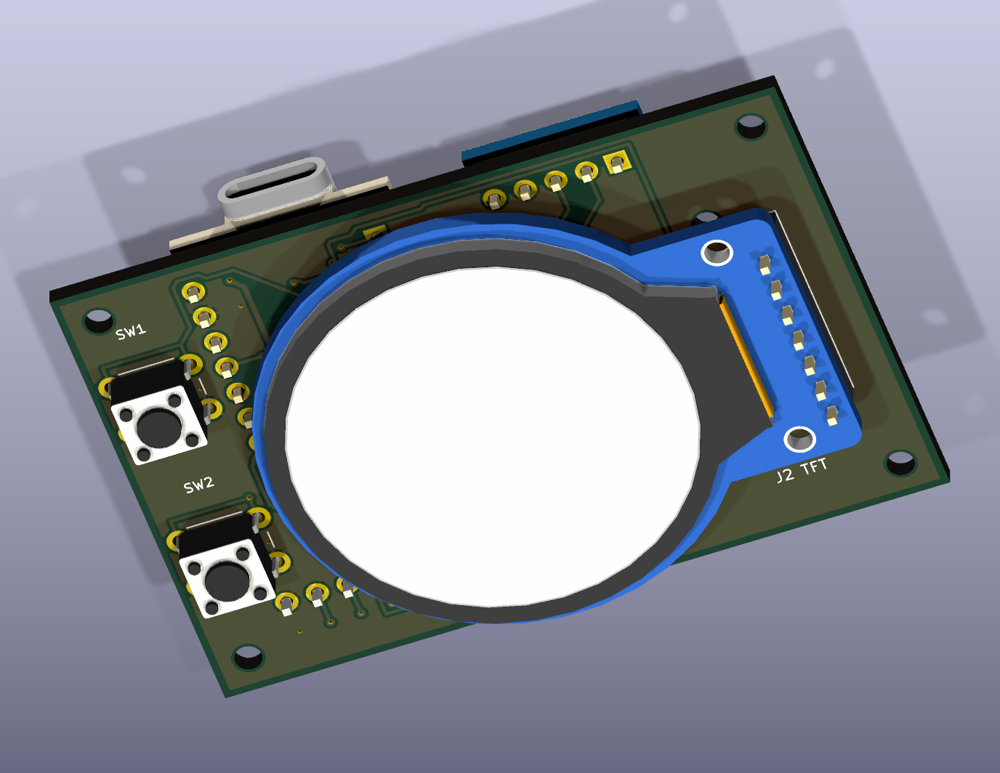
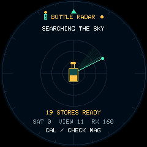
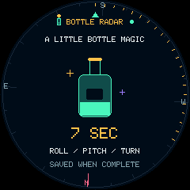

# Waypoint Compass

**An offline GPS navigation device combining sensor integration, embedded UI, and custom PCB design.**

[](https://github.com/albash0/WaypointCompass/actions/workflows/host-tests.yml)

| Navigation interface | Module-carrier design |
| --- | --- |
|  |  |

*Left: a firmware-rendered test fixture using a public business location. Right: a CAD assembly render. Neither image is a photograph or a live navigation measurement.*

Waypoint Compass uses GPS position, a magnetometer, and accelerometer-based tilt compensation to show a target's direction and straight-line distance on a round display. It runs without a phone, Wi-Fi, or an external service. The project spans an earlier OLED prototype, a module-based color version, and a compact integrated PCB design.

A project by [albash0](https://github.com/albash0), a first-year ASEN and CTD student at CU Boulder.

[Engineering notes](docs/ENGINEERING.md) · [Hardware versions](#hardware-versions) · [Build instructions](docs/BUILD.md) · [Controls and wiring](WaypointCompass/README.md) · [Validation](VALIDATION.md)

## About the project

The core problem is making a small navigation display useful when its position, heading, and tilt inputs have different failure modes. The firmware includes calibration, sensor-frame alignment, data-age checks, and visible acquisition/lost-fix states. A target arrow is withheld when the GPS fix is missing or stale.

### My project work

| Area | Work in this project | Source and evidence |
| --- | --- | --- |
| Sensor integration | UART GPS, I²C magnetometer/accelerometer setup, magnetic calibration, frame alignment, and tilt-compensated heading | [SuperMini firmware](WaypointCompass/WaypointCompass.ino), [compact sensor mapping](WaypointCompass/CompactPCB/firmware/WaypointCompassCompact/WaypointCompassCompact.ino) |
| Navigation and interaction | Target bearing/distance, invalid-fix handling, offline nearest-target selection, diagnostics, and a round-screen interface | [Navigation logic](WaypointCompass/BottleNavigation.h), [shared UI](WaypointCompass/BottleUI.h) |
| Hardware design | Modular carrier and a compact four-layer design with onboard sensors and battery power circuitry | [Module carrier](WaypointCompass/PCB/), [C1 design and status](WaypointCompass/CompactPCB/README.md) |
| Verification and tooling | Geographic edge-case tests, real-renderer previews, three firmware builds, and a public-data update script | [Tests](WaypointCompass/tests/), [data updater](WaypointCompass/tools/update_store_list.py), [validation report](VALIDATION.md) |

The project uses TinyGPSPlus, Adafruit display libraries, and KiCad library material. Original contributors and data sources retain their licenses and credits; [third-party notices](THIRD_PARTY.md) describe those boundaries.

### Engineering decisions

- **Use gravity to account for tilt:** align the sensor frames and project magnetic/device-forward vectors onto the horizontal plane when the calibration and input checks permit.
- **Make stale input visible:** missing or outdated GPS data switches the display into an acquisition/lost-fix state.
- **Keep navigation offline:** a small flash-resident target set supports deterministic nearest-target selection without connectivity.
- **Separate software checks from hardware validation:** the compact design compiles, but its electronics still require bench bring-up.

[Read the implementation choices, tradeoffs, and proposed measurements →](docs/ENGINEERING.md)

### Status and validation

| Check | Evidence and limits |
| --- | --- |
| Navigation tests | All **19 public target points**, invalid/stale fixes, and geographic distance edge cases checked under address/undefined-behavior sanitizers. [GitHub Actions](https://github.com/albash0/WaypointCompass/actions). |
| UI | **Eight display states** rendered through actual Adafruit GFX code; examples below. |
| Firmware | SuperMini color, compact C1 color, and earlier OLED versions compiled for the public source release. |
| Module prototype | Documented as the working module-based firmware; publication did not add a new sensor/field test. |
| Compact C1 | Routed schematic/PCB and historical CAD reports are available. **Physical hardware remains unverified.** |
| Open measurements | Absolute heading accuracy, tilt/motion sensitivity, GPS acquisition time, and C1 power/charging behavior remain to be measured. |

Calibration and compilation do not establish a heading-accuracy specification. [Validation details](VALIDATION.md).

### Timeline

These dates come from retained sketch/PCB files and dated update records. They are development milestones, not an imported Git commit history.

| Date | Milestone |
| --- | --- |
| 2026-09-29 | Earliest retained OLED waypoint compass sketch: GPS, QMC5883P heading, calibration and a configurable destination. |
| 2026-09-30 | Round TFT bring-up and signal-pin diagnostics. |
| 2026-10-01 | Modular 60 × 40 mm carrier PCB design retained. |
| 2026-10-02 | Compact C1 integrated 54 × 40 mm four-layer PCB design retained, with onboard sensors and battery power circuitry. |
| 2026-10-16 | Bottle Radar update: nearest-of-19 store selection, shared UI/navigation code, GPS reception details, calibration animation and automated navigation/rendering checks. |
| 2026-11-17 | Public source preparation, removal of private waypoint defaults, and self-contained test dependencies. |


## Hardware versions

| Version | Hardware | Source |
| --- | --- | --- |
| Module-based color prototype | ESP32-S3 SuperMini, GC9A01 round TFT, QMC5883P GY-271, MPU6050 GY-521, UART GPS | [Sketch](WaypointCompass/WaypointCompass.ino), [60 × 40 mm carrier](WaypointCompass/PCB/) |
| Compact C1 prototype | ESP32-S3-MINI-1U-N4R2, LIS2MDL/LIS2DH12, USB-C, battery charging/protection; 54 × 40 mm four-layer PCB | [Firmware and board requirements](WaypointCompass/CompactPCB/README.md) — bench-unverified |
| Earlier OLED waypoint compass | ESP32-S3 SuperMini, SSD1306, QMC5883P, UART GPS; manual target | [Sketch](WaypointCompassOLED/WaypointCompassOLED.ino) |

Read the C1 battery thermistor, polarity, and charging requirements before fabrication or assembly. Supplier reference solids without a local redistribution-license record are omitted; the electrical designs remain editable.

## Interface and application mode

| Acquiring GPS | Calibration |
| --- | --- |
|  |  |

*Host-rendered test states, not live reception or calibration measurements.*

**Bottle Radar** is an application mode that selects the nearest of 19 Boulder retail liquor stores from a dated public city dataset. Manual waypoints are also supported. Distances are straight-line; the device does not provide walking routes, entrance surveys, opening hours, or live closure checks. The embedded data is a **2026-10-16 snapshot** of the [City of Boulder map](https://maps.bouldercolorado.gov/liquor-licenses/).

Private destination defaults are unset. Enter `latitude,longitude` in Serial Monitor at 115200 baud to save a personal target. On the color variants, `NEAREST` restores automatic selection. Calibration and destinations remain on the device. [Full commands, display states and prototype wiring](WaypointCompass/README.md).

## Build and test

[The build guide](docs/BUILD.md) covers the ESP32 core, display/GPS dependencies, and board-specific settings. From the repository root:

```sh
arduino-cli compile --fqbn esp32:esp32:esp32s3:CDCOnBoot=cdc,USBMode=hwcdc,FlashSize=4M --libraries libraries WaypointCompass
sh WaypointCompass/tests/run_tests.sh
```

To refresh the public target dataset, run `python3 WaypointCompass/tools/update_store_list.py`, review the result, and recompile. Both color variants must keep their copied navigation, data, and UI headers synchronized.

## License and credits

Original software, documentation and hardware designs: **GPL-2.0-or-later**, except retained third-party notices. See [LICENSE](LICENSE) and [THIRD_PARTY.md](THIRD_PARTY.md). Adafruit/KiCad material and public city data retain their original notices and applicable publisher terms.
